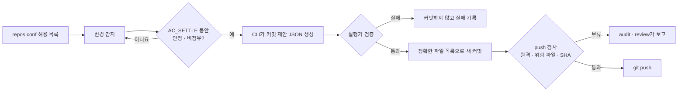

<div align="center">

# autocommit

**허용한 저장소만, 안정된 변경만, 검증을 통과한 커밋과 push만.**

Conservative auto-commit loop for herdr that delegates commits to coding CLIs

[](LICENSE)


[English](README.md) · **한국어**

[설치](#설치와-빠른-시작) · [명령](#명령) · [CLI 선택](#커밋을-맡길-cli) · [환경 변수](#환경-변수) · [FAQ](#자주-묻는-질문)

</div>

---

`autocommit`은 [herdr](https://herdr.dev/tui/docs/install/) 안에서 도는 보수적인 Git 자동 커밋 루프입니다. 허용 목록에 적은 저장소만 살피고, 변경이 충분히 안정되면 코딩 CLI(claude·opencode·agy·codex)에게 원자적인 커밋을 맡깁니다. push는 별도 검증을 통과한 경우에만 합니다. 확인할 수 없는 상태는 성공으로 보지 않고 보류합니다.

## 주요 특징

- **허용 목록 기반**: `repos.conf`에 사람이 적은 저장소만 관리합니다. 새 저장소는 찾아서 알리기만 하고 자동 등록하지 않습니다.
- **안정화 뒤 커밋**: 변경이 `AC_SETTLE`(기본 10분) 동안 그대로여야 커밋하고, 에이전트가 작업 중인 워크트리는 건드리지 않습니다.
- **도구 없는 커밋 제안**: claude·opencode·agy는 셸·파일 도구 없이 커밋 제안 JSON만 만들고, 로컬 실행기가 검증한 뒤 정확한 파일 목록으로 커밋합니다.
- **보수적인 push**: 허용된 원격, 위험 파일·대용량 blob 검사, SHA 안정화를 모두 통과해야 push합니다.
- **사람이 푸는 보류**: 검증 실패나 중단으로 남은 보류는 `audit`·`review`가 보고하고, 사람이 `unblock`으로 풉니다.

## 작동 방식



## 설치와 빠른 시작

준비물: Linux, [herdr](https://herdr.dev/tui/docs/install/), 커밋을 맡길 CLI 하나(로그인 완료). 대상 저장소에 `git config user.name`·`user.email`이 설정돼 있어야 하고, 셸과 herdr pane의 `PATH`에 `~/.local/bin`이 있어야 합니다.

```bash
git clone https://github.com/namu-k/autocommit.git
cd autocommit
./install.sh --init-config     # ~/.local/bin/autocommit 링크 + 예제 설정 복사(없을 때만)
```

설치는 이 폴더를 가리키는 심볼릭 링크라서 폴더를 옮기거나 지우면 끊깁니다. 이제 herdr pane 안에서 다음을 실행합니다.

```bash
$EDITOR ~/.config/autocommit/repos.conf          # 관리할 저장소를 적는다
export AC_AGENT=claude                            # 커밋을 맡길 CLI
export AC_REMOTE_ALLOW='^(git@github\.com:|https://github\.com/)<계정>/'   # push 허용 원격. 비우면 push 안 함
autocommit plan                                   # 판정만 확인
autocommit up                                     # loop 시작
```

`repos.conf` 한 행은 `저장소 경로  commit 브랜치 glob  push 원격  [push 브랜치 glob]`이고, `-`는 그 단계를 끕니다. 예: `~/workspace/my-repo main -`는 main에 커밋만 하고 push하지 않습니다. 경로에는 공백이나 `#`를 쓸 수 없습니다. 처음에는 `export AC_PUSH=0`으로 push 없이 지켜보는 것을 권장합니다. 예제는 [examples/repos.conf](examples/repos.conf)에 있습니다.

## 명령

| 명령 | 역할 |
| --- | --- |
| `autocommit up` | herdr에 `autocommit` 탭을 만들고 loop를 시작합니다. 현재 `AC_*` 환경 변수를 그대로 넘깁니다. |
| `autocommit loop` / `once` | loop를 전면에서 실행 / 한 번만 실행합니다. |
| `autocommit plan` | 아무것도 쓰지 않고 판정만 출력합니다. |
| `autocommit push-only` | 커밋 없이 push만 합니다. 안정화 대기만 생략하고 나머지 검사는 같습니다. |
| `autocommit scan` | 허용 목록 밖 Git 저장소를 찾아 출력합니다. |
| `autocommit audit` | 저절로 풀리지 않는 보류 상태를 점검합니다. |
| `autocommit tidy` | 더 이상 아무것도 막지 않는 상태 마커만 지웁니다. |
| `autocommit review` | 남은 보류 항목을 분류한 보고서를 만들고 메일로 보냅니다. |
| `autocommit unblock <저장소> [<브랜치>]` | 보류를 사람이 해제합니다. loop를 멈춘 뒤 실행합니다. |

`up`·`loop`·`once`는 herdr 안에서만 실행됩니다. `plan`·`scan`·`audit`는 읽기 전용입니다.

## 커밋을 맡길 CLI

`AC_AGENT`로 고릅니다. 지정하지 않으면 loop가 시작되지 않습니다. 모델은 `AC_AGENT_MODEL`로 바꿀 수 있습니다.

| `AC_AGENT` | 권한 | 비고 |
| --- | --- | --- |
| `claude` | 도구 전체 제거, 사용자·프로젝트 설정·MCP 제외 | 사전 로그인 필요 |
| `opencode` | 전용 agent의 모든 도구 거부 | `--standalone`을 지원하는 V2 필요 |
| `agy` | `strict` + 모든 도구 deny | |
| `codex` | **제한 없음** | `AC_AGENT_UNRESTRICTED=1` 동의 필수. 에이전트의 push를 막지 못합니다. |

> [!WARNING]
> 변경 내용(diff)은 선택한 CLI의 모델 제공자에게 전송됩니다. 전송해도 되는 저장소만 등록하세요. 비밀 경로·심볼릭 링크·binary·큰 미추적 파일은 자료와 커밋 후보에서 제외합니다. 대상 저장소의 Git hooks는 그대로 실행되므로 신뢰하는 저장소에서만 사용하세요.

부분적으로 stage한 파일은 자동 커밋 후보에서 빠집니다. 파일 일부만 나눠 커밋해야 하면 직접 커밋하세요. 다른 실행기를 쓰려면 `AC_HOC=<명령>`을 지정합니다. 저장소 폴더에서 `<명령> -c <추가 지시>`로 불리고, 성공하면 0으로 끝나야 합니다.

## 안전장치 요약

- **커밋 보류**: 에이전트가 작업 중(`working`·`blocked`·`unknown`)이거나 상태 조회가 실패하면 커밋하지 않습니다.
- **push 조건**: 원격 URL이 `AC_REMOTE_ALLOW`에 맞아야 합니다. 새로 게시될 모든 커밋에 금지 경로나 `AC_MAX_FILE_MB`(기본 50MB) 초과 파일이 없어야 하고, 브랜치 SHA가 `AC_SETTLE` 동안 그대로여야 합니다.
- **장시간 미커밋 변경**: 3시간(`AC_CHECKPOINT_AFTER`)이 지나면 codex가 읽기 전용으로 현황을 조사해 보고서를 남깁니다. 강제 커밋은 하지 않습니다.
- **커밋 도중 중단**: 실행 기록 `inflight-*`가 남아 그 저장소의 자동 commit·push를 모두 막습니다. 다음 순서로 풉니다.
  1. `autocommit audit`로 기록과 확인 명령을 봅니다.
  2. loop를 멈추고 HEAD·브랜치와 `~/.local/state/autocommit/hoc.log`를 확인합니다.
  3. `autocommit unblock <저장소>`, 필요하면 `autocommit unblock <저장소> <브랜치>`로 풉니다.

  해제는 보류를 지울 뿐이고, 다음 push도 모든 검사를 다시 거칩니다.

## 주간 review (선택)

```bash
./install.sh --enable-review-timer     # 매주 월요일 09:00 review 실행
systemctl --user disable --now autocommit-review.timer   # 끄기
```

보고서는 `~/.local/state/autocommit/review-<시각>.md`에 남습니다. codex가 없으면 분류 없이 점검 결과만 담깁니다. 메일은 `AC_REVIEW_MAIL_CMD`로 보냅니다(인자 = 제목, 표준 입력 = 본문). timer는 loop의 환경 변수를 물려받지 않으므로 `systemctl --user edit autocommit-review.service`에 `Environment=AC_REMOTE_ALLOW=...`를 넣으세요.

## 환경 변수

| 변수 | 기본값 | 역할 |
| --- | ---: | --- |
| `AC_AGENT` | 없음 (필수) | 커밋을 맡길 CLI |
| `AC_REMOTE_ALLOW` | 없음 | push 허용 원격 URL 정규식. 비우면 push 안 함 |
| `AC_PUSH` | 1 | `0`이면 push 전체를 끕니다 |
| `AC_INTERVAL` | 900초 | 활동 중인 저장소 확인 주기 |
| `AC_IDLE_MAX_INTERVAL` | 86400초 | 깨끗한 저장소의 최대 확인 주기 |
| `AC_SETTLE` | 600초 | 커밋·push 전 안정화 시간 |
| `AC_FIRST_SETTLE` | 3600초 | loop 시작 직후의 안정화 시간 |
| `AC_CHECKPOINT_AFTER` | 10800초 | 장시간 미커밋 변경 현황 조사 기준 (`0`이면 끔) |
| `AC_SCAN_INTERVAL` | 86400초 | 새 저장소 탐지 주기 (`0`이면 끔) |
| `AC_MAX_FILE_MB` | 50 | push할 이력의 파일 크기 상한 |

전체 변수와 검증 조건은 [bin/autocommit](bin/autocommit) 머리말에 있습니다.

## 요구 사항과 테스트

Linux, Bash 4.4+, `git`, `jq`, GNU coreutils·grep·findutils, util-linux(`flock`)가 필요합니다. claude·opencode·agy 경로에는 Python 3.8+(표준 라이브러리만 사용)도 필요합니다. systemd는 주간 review에만 씁니다.

```bash
python3 -m unittest discover -s tests -v
```

## 자주 묻는 질문

**자동으로 push까지 하나요?**
`AC_REMOTE_ALLOW`에 맞는 원격에만 합니다. 비워 두거나 `AC_PUSH=0`이면 push하지 않습니다.

**내 코드가 외부로 전송되나요?**
네. 변경 내용이 선택한 CLI의 모델 제공자에게 전송됩니다.

**herdr 없이 쓸 수 있나요?**
`plan`·`scan`·`audit`만 쓸 수 있습니다. loop는 herdr 안에서만 돕니다.

**새 저장소도 자동으로 관리되나요?**
아니요. `scan`이 알려 주면 사람이 `repos.conf`에 추가합니다.

**macOS에서도 되나요?**
지원 환경은 Linux입니다(GNU 도구가 필요합니다).

## 라이선스

[MIT](LICENSE)
