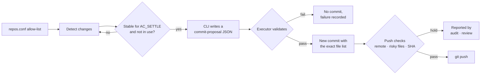

<div align="center">

# autocommit

**Only allow-listed repos. Only settled changes. Only verified commits and pushes.**

A conservative Git auto-commit loop for herdr that delegates atomic commits to coding CLIs — Claude Code, OpenCode, agy, or Codex.

[](LICENSE)


**English** · [한국어](README.ko.md)

[Install](#install-and-quick-start) · [Commands](#commands) · [Choosing a CLI](#choosing-a-commit-cli) · [Safety](#safety-guarantees) · [Environment](#environment-variables) · [FAQ](#faq)

</div>

---

**autocommit** is a conservative Git auto-commit loop that runs inside [herdr](https://herdr.dev/tui/docs/install/), a terminal multiplexer for coding agents. It watches only the repositories you allow-list, waits until changes have settled, and asks a coding CLI (`claude`, `opencode`, `agy`, or `codex`) to create atomic commits. It pushes only after separate verification. Anything it cannot verify is held, never assumed safe.

## Features

- **Allow-list only**: manages just the repositories you list in `repos.conf`. New repositories are detected and reported, never auto-registered.
- **Commits after changes settle**: a worktree must stay unchanged for `AC_SETTLE` (default 10 min), and worktrees where an agent is still working are left alone.
- **Tool-less commit proposals**: with `claude`, `opencode`, and `agy`, the model gets no shell or file tools. It only returns a commit-proposal JSON, which a local executor validates before committing the exact file list.
- **Conservative push**: pushes only to allowed remotes, after risky-path, large-blob, and SHA-stability checks.
- **Human-released holds**: holds left by failed verification or interruption are reported by `audit` / `review` and released by a person with `unblock`.

## How it works



## Install and quick start

You need Linux, [herdr](https://herdr.dev/tui/docs/install/), and one commit CLI that is already logged in. Each target repository needs `git config user.name` and `user.email`, and `~/.local/bin` must be on `PATH` in both your shell and herdr panes.

```bash
git clone https://github.com/namu-k/autocommit.git
cd autocommit
./install.sh --init-config     # links ~/.local/bin/autocommit and copies example config if missing
```

The install is a symlink to this folder, so moving or deleting the folder breaks it. Then, inside a herdr pane:

```bash
$EDITOR ~/.config/autocommit/repos.conf          # list the repositories to manage
export AC_AGENT=claude                            # which CLI makes commits
export AC_REMOTE_ALLOW='^(git@github\.com:|https://github\.com/)<owner>/'   # allowed push remotes; empty = never push
autocommit plan                                   # show decisions only
autocommit up                                     # start the loop
```

Each `repos.conf` line is `repo-path  commit-branch-glob  push-remote  [push-branch-glob]`, and `-` disables that step. For example, `~/workspace/my-repo main -` commits on `main` but never pushes. Paths cannot contain spaces or `#`. Start with `export AC_PUSH=0` to watch it work without pushing. See [examples/repos.conf](examples/repos.conf).

## Commands

| Command | What it does |
| --- | --- |
| `autocommit up` | Opens an `autocommit` tab in herdr and starts the loop, passing along your current `AC_*` variables. |
| `autocommit loop` / `once` | Runs the loop in the foreground / runs one pass. |
| `autocommit plan` | Prints decisions without writing anything. |
| `autocommit push-only` | Pushes without committing. Skips only the settle wait; every other check still applies. |
| `autocommit scan` | Lists Git repositories outside the allow-list. |
| `autocommit audit` | Reports holds that will not clear on their own. |
| `autocommit tidy` | Removes only state markers proven to block nothing. |
| `autocommit review` | Builds a classified report of remaining holds and emails it. |
| `autocommit unblock <repo> [<branch>]` | Releases a hold by hand. Stop the loop first. |

`up`, `loop`, and `once` run only inside herdr. `plan`, `scan`, and `audit` are read-only.

## Choosing a commit CLI

Set `AC_AGENT`; the loop will not start without it. Pick a model with `AC_AGENT_MODEL`.

| `AC_AGENT` | Restrictions | Notes |
| --- | --- | --- |
| `claude` | All tools removed; user/project settings and MCP excluded | Log in first |
| `opencode` | Dedicated agent with every tool denied | Requires V2 with `--standalone` |
| `agy` | `strict` plus every tool denied | |
| `codex` | **None** | Requires explicit `AC_AGENT_UNRESTRICTED=1`. Cannot stop the agent from pushing. |

> [!WARNING]
> Diffs are sent to the model provider of the CLI you choose, so register only repositories you are allowed to share. Secret paths, symlinks, binaries, and large untracked files are excluded from both the model input and commit candidates. The target repository's Git hooks still run, so use autocommit only on repositories you trust.

Partially staged files are skipped. Commit those yourself when you need to split changes within a file. To use another executor, set `AC_HOC=<command>`. It is called as `<command> -c <extra instructions>` from the repository folder and must exit 0 on success.

## Safety guarantees

- **Commit holds**: no commit while an agent is `working`, `blocked`, or `unknown`, or when a status query fails.
- **Push conditions**: the remote URL must match `AC_REMOTE_ALLOW`. No commit about to be published may touch a forbidden path or contain a file over `AC_MAX_FILE_MB` (default 50 MB), and the branch SHA must stay unchanged for `AC_SETTLE`.
- **Long-lived uncommitted changes**: after 3 hours (`AC_CHECKPOINT_AFTER`), codex surveys the worktree read-only and leaves a report. Nothing is force-committed.
- **Interrupted commits**: an `inflight-*` record stays behind and blocks all automatic commits and pushes for that repository. To recover:
  1. Run `autocommit audit` to see the record and the suggested check commands.
  2. Stop the loop and compare HEAD, the branch, and `~/.local/state/autocommit/hoc.log`.
  3. Run `autocommit unblock <repo>`, and if needed `autocommit unblock <repo> <branch>`.

  Releasing a hold is not a safety check: the next push goes through every check again.

## Weekly review (optional)

```bash
./install.sh --enable-review-timer                       # run review every Monday at 09:00
systemctl --user disable --now autocommit-review.timer   # turn it off
```

Reports go to `~/.local/state/autocommit/review-<time>.md`. Without codex, the report holds the raw audit output, unclassified. Mail is sent through `AC_REVIEW_MAIL_CMD` (argument = subject, stdin = body). The timer does not inherit the loop's environment, so add `Environment=AC_REMOTE_ALLOW=...` with `systemctl --user edit autocommit-review.service`.

## Environment variables

| Variable | Default | Purpose |
| --- | ---: | --- |
| `AC_AGENT` | none (required) | CLI that makes commits |
| `AC_REMOTE_ALLOW` | none | Regex of allowed push remote URLs; empty = never push |
| `AC_PUSH` | 1 | `0` disables pushing entirely |
| `AC_INTERVAL` | 900 s | Check interval for active repositories |
| `AC_IDLE_MAX_INTERVAL` | 86400 s | Maximum check interval for clean repositories |
| `AC_SETTLE` | 600 s | Settle time before commit and push |
| `AC_FIRST_SETTLE` | 3600 s | Settle time right after the loop starts |
| `AC_CHECKPOINT_AFTER` | 10800 s | When to survey long-lived uncommitted changes (`0` = off) |
| `AC_SCAN_INTERVAL` | 86400 s | New-repository scan interval (`0` = off) |
| `AC_MAX_FILE_MB` | 50 | Maximum file size in history to be pushed |

All variables and their validation rules are documented at the top of [bin/autocommit](bin/autocommit).

## Requirements and tests

Linux, Bash 4.4+, `git`, `jq`, GNU coreutils/grep/findutils, and util-linux (`flock`). The `claude`, `opencode`, and `agy` paths also need Python 3.8+ (standard library only). systemd is used only for the weekly review.

```bash
python3 -m unittest discover -s tests -v
```

## FAQ

**Does it push automatically?**
Only to remotes matching `AC_REMOTE_ALLOW`. It never pushes if that is empty or `AC_PUSH=0`.

**Is my code sent anywhere?**
Yes. Diffs go to the model provider of the CLI you choose.

**Can I use it without herdr?**
Only `plan`, `scan`, and `audit`. The loop runs only inside herdr.

**Are new repositories managed automatically?**
No. `scan` reports them, and you add them to `repos.conf` yourself.

**Does it run on macOS?**
Linux is the supported platform; it relies on GNU tools.

## License

[MIT](LICENSE)
